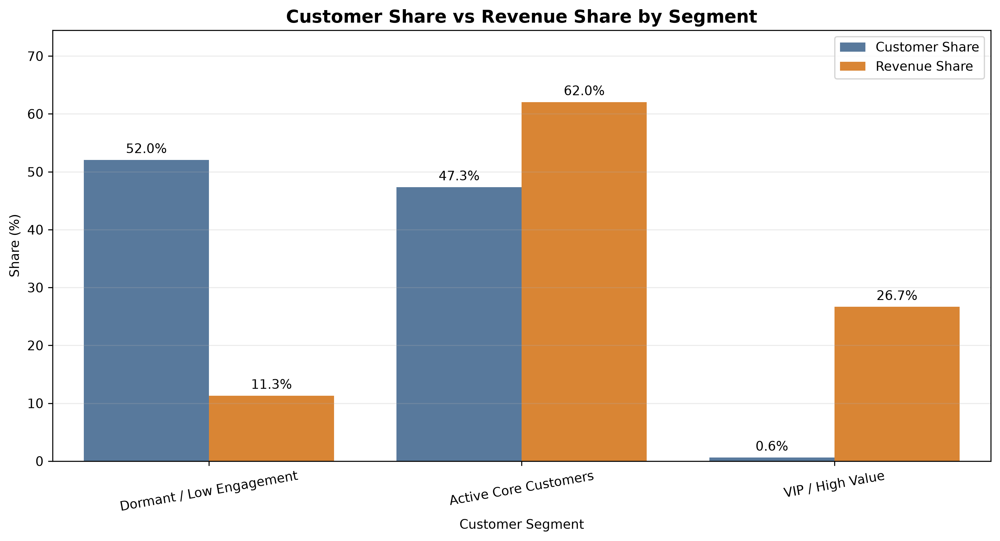
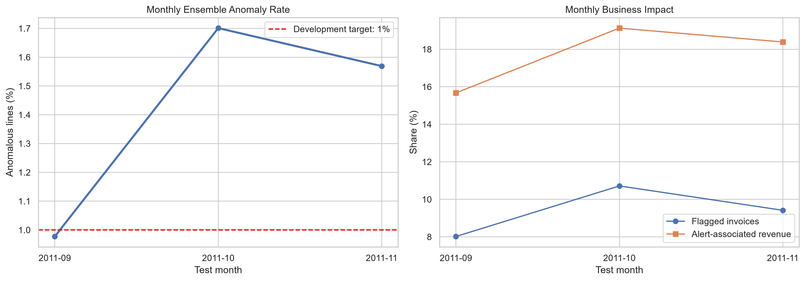
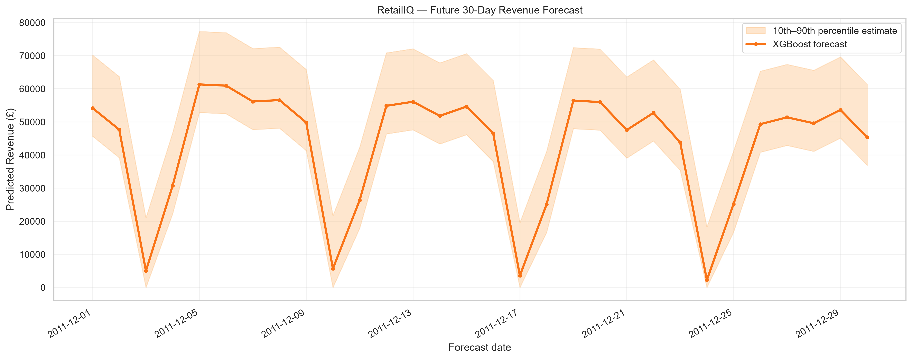
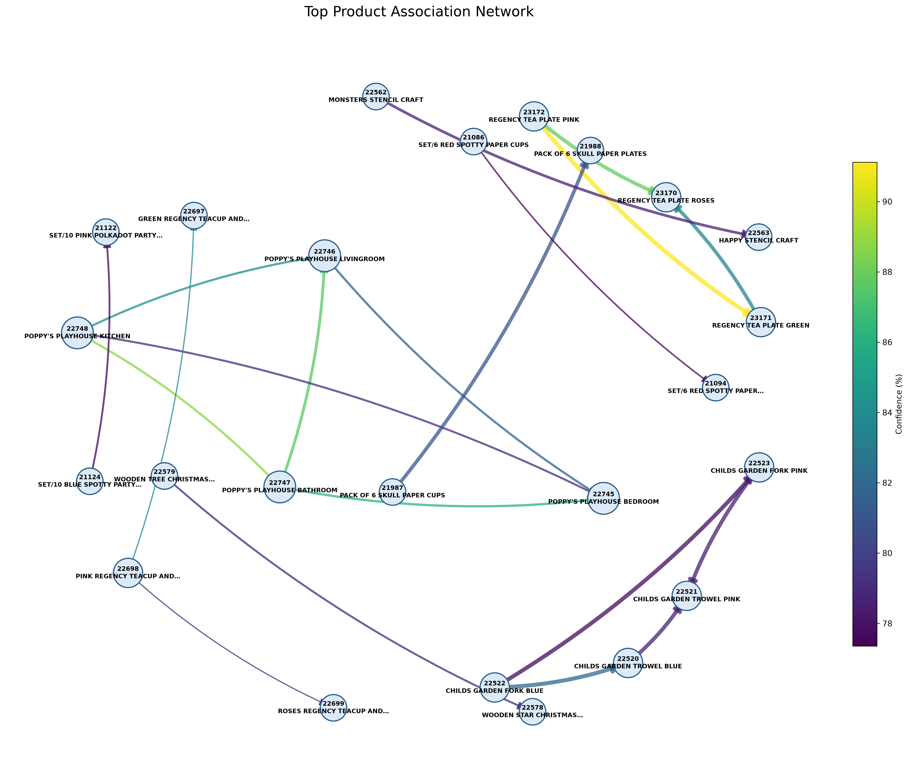
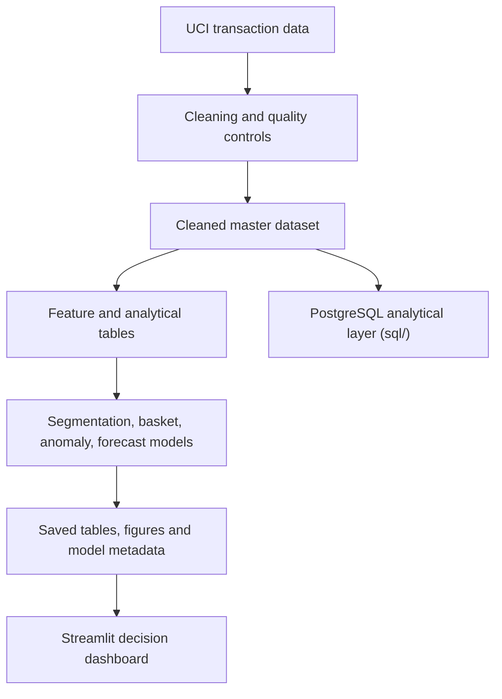

# RetailIQ: AI-Powered Retail Financial Intelligence

[](https://github.com/Anna-datascience/retail-financial-intelligence/actions)


**RetailIQ turns 1 million+ retail transactions into decisions for Finance, Customer Operations and Merchandising:** customer segments, product and basket insights, a prioritised invoice-review queue, and a 30-day revenue forecast, all in an interactive dashboard.

> **Live demo:** `[add Streamlit Community Cloud link here]`  
> **Status:** analytics, dashboard and PostgreSQL layer complete. Cloud deployment and database-backed dashboard loaders are the next phases (see [Roadmap](#roadmap)).

### Preview

| Customer segments | Anomaly monitoring |
| --- | --- |
|  |  |

| 30-day revenue forecast | Product associations |
| --- | --- |
|  |  |

<!-- Tip: add 1-2 screenshots of the live Streamlit dashboard to reports/figures/dashboard/ and show them here. -->

---

## Why this project

Finance teams rarely get clean, reconciled transaction data. This project shows the full path from raw transactions to action:

1. **Clean and control the data** with auditable rules instead of silently dropping rows.
2. **Find who and what matters** with RFM, K-Means segmentation and market-basket analysis.
3. **Flag what needs review** with an Isolation Forest plus rule-based checks, aggregated into prioritised invoice cases.
4. **Plan ahead** with a tuned forecasting model that beats a transparent benchmark.
5. **Communicate** the results in a dashboard that business users can actually read.

The questions it answers:

1. Which customers are active, valuable, inactive or strategically important?
2. Which products generate revenue, sell together or show signs of inactivity?
3. Which invoices and transaction lines require financial or operational review?
4. What daily revenue should the business expect over the next 30 days?
5. Which actions should Finance, Customer Operations and Merchandising prioritise?

All monetary values are in pounds sterling (GBP, £).

---

## Key results

| Area | Result |
| --- | --- |
| Cleaned transaction master | 1,033,036 rows after exact-duplicate removal (from 1,067,371 raw lines); original records retained through documented classifications and flags |
| Customer modelling population | 5,839 eligible customers after documented exclusions |
| Customer segmentation | 3 K-Means segments, supported by RFM and behavioural profiles |
| Market-basket matrix | 34,497 invoices × 1,000 products, 675,889 non-zero basket entries |
| Anomaly review queue | 1,009 invoice cases: 267 P1, 517 P2, 225 P3 |
| Forecast test period | 91 complete daily observations, 1 Sep – 30 Nov 2011 |
| Selected forecasting model | Tuned XGBoost (raw target) |
| Test WAPE | **25.287 %** vs 31.138 % for the same-weekday baseline (≈ 18.8 % lower error) |

Model-generated anomalies are **review candidates, not confirmed fraud**. Product inactivity is a decision-support signal, not proof that a product was discontinued.

### Main business findings

- **Revenue is concentrated in a small active base.** The *Active Core* segment (2,764 customers, 47.3 % of the modelled base) generates 62.0 % of net customer revenue, and 36 *VIP / Strategic* customers (0.6 %) add another 26.7 %. Together, about 48 % of customers produce roughly 89 % of net revenue.
- **Over half of the customers are dormant.** 3,039 customers (52.0 %) are *Inactive / Low Frequency*: a median of one order, average recency of about 340 days, and only 11.3 % of revenue. This group is the natural target for win-back campaigns.
- **Review effort can be prioritised.** The 1,009 anomaly cases are ranked: 267 P1 cases were flagged by both the model and the rule-based checks and should be reviewed first; 517 P2 cases need financial reconciliation; 225 P3 cases are monitoring candidates.
- **Cross-selling opportunities exist around coordinated collections.** The strongest co-purchase rules cluster around product sets such as children's garden tools and Regency tableware (observed co-purchase, not causation; validate with controlled tests).
- **December 2011 outlook.** The 30-day forecast expects about £1.28 million in total (≈ £42.7k per day), with the sum of the daily lower and upper estimates spanning roughly £1.04 million to £1.76 million.

---

## Dataset

**UCI Online Retail II**: transactions of a UK-based non-store retailer, 1 December 2009 – 9 December 2011.

- Source: [UCI Machine Learning Repository, Online Retail II](https://archive.ics.uci.edu/dataset/502/online%2Bretail)
- DOI: [10.24432/C5CG6D](https://doi.org/10.24432/C5CG6D)
- Creator: Daqing Chen
- Licence: [CC BY 4.0](https://creativecommons.org/licenses/by/4.0/)
- Raw observations: 1,067,371 transaction lines

The raw data is not committed. Download it from the link above and place the file(s) under `data/raw/`.

---

## Solution architecture



The dashboard reads saved, validated artifacts instead of retraining models on every page load. This keeps the app fast and separates modelling from presentation.

---

## Analytical workflow

### 1. Data cleaning and quality

- Standardise data types, dates, customer identifiers and stock codes.
- Remove exact duplicate rows; keep the raw source separately.
- Recalculate line revenue as `Quantity × Price`.
- Classify sales, cancellations, postage, adjustments, discounts, charges, tests, bad debt and review-required rows.
- Preserve genuine product codes such as `PADS`; alphabetic codes are not classified automatically.
- Create flags for missing values, rule violations, extreme values, cancellations and reversal pairs.

### 2. Exploratory analysis

- Revenue and order trends by time and geography.
- Customer acquisition and cohort retention.
- Product ABC contribution and lifecycle analysis.
- Inactive and low-frequency product candidates, using complete observation periods.
- Cancellation and financial-activity analysis.

### 3. Customer intelligence

- Features: recency, frequency, monetary value, average order value, units purchased, unique products, cancellation rate.
- Interpretable RFM scores and business segments.
- Skew transformation, scaling and K-Means clustering.
- Cluster count chosen with inertia, silhouette score, cluster size and stability checks.

### 4. Market-basket analysis

- Sparse invoice-product basket from valid product sales.
- Frequent itemsets and association rules.
- Ranking by support, confidence, lift and basket count.

### 5. Anomaly detection

- Chronological split into development and final test data.
- Isolation Forest ensemble compared with transparent rule-based baselines.
- Checks for temporal stability, novelty effects, seed sensitivity and ensemble robustness.
- Anomalous lines aggregated into invoice cases with P1–P3 priority, owner, reason and recommended action.

### 6. Revenue forecasting

- Clean sales aggregated into a continuous daily series; incomplete final month excluded from backtesting.
- Chronological train, validation and untouched test periods.
- Compared: same-weekday 4-week baseline, tuned XGBoost, 30-day-sequence LSTM.
- Deployment model selected primarily by WAPE; recursive 30-day forecast with empirical uncertainty ranges.

#### Forecast test results

| Model | MAE (£) | RMSE (£) | WAPE | sMAPE | Bias |
| --- | ---: | ---: | ---: | ---: | ---: |
| Tuned XGBoost (raw target) | 9,800.317 | 14,121.721 | 25.287 % | 51.345 % | -2.675 % |
| Same-weekday 4-week average | 12,068.298 | 16,978.475 | 31.138 % | 33.967 % | -12.418 % |
| LSTM 30-day sequence | 20,272.255 | 27,115.922 | 52.306 % | 85.758 % | -50.139 % |

**Why WAPE?** WAPE weights errors by revenue, so it reflects the cash impact of the forecast. sMAPE is inflated on low-revenue days, which is why it ranks the models differently here. The same-weekday method is the mandatory benchmark. XGBoost is selected for the lowest test WAPE; the LSTM is kept as a documented deep-learning experiment, not as the deployment model.

---

## Dashboard

The Streamlit app has five pages:

1. **Customer Intelligence**: segments, RFM behaviour, value and customer drill-downs.
2. **Product and Basket Intelligence**: product lifecycle, contribution and association rules.
3. **Anomaly Monitor**: case priorities, owners, invoice details and monitoring trends.
4. **Revenue Forecasting**: model comparison, test predictions and future estimates.
5. **Business Recommendations**: findings from all workstreams translated into actions.

---

## Quick start

Run from the repository root.

**Windows (PowerShell)**

```powershell
py -m venv .venv
.\.venv\Scripts\Activate.ps1
python -m pip install --upgrade pip
python -m pip install -r requirements.txt
```

**macOS / Linux**

```bash
python3 -m venv .venv
source .venv/bin/activate
python -m pip install --upgrade pip
python -m pip install -r requirements.txt
```

Validate the dashboard artifacts, then start the app:

```bash
python scripts/validate_dashboard_artifacts.py
python -m streamlit run dashboard/app.py --browser.gatherUsageStats false
```

If PowerShell blocks activation, select the interpreter in VS Code or call `.\.venv\Scripts\python.exe` directly.

### Reproduce the analysis

1. Download the dataset and place it under `data/raw/`.
2. Install development dependencies: `python -m pip install -r requirements-dev.txt`
3. Run the notebooks in `notebooks/` in numerical order (cleaning → EDA → segmentation → basket → anomaly → forecasting).
4. Re-run the validation script and start the dashboard.

`requirements.txt` holds only what the dashboard needs. `requirements-dev.txt` adds notebook, EDA, market-basket, XGBoost and TensorFlow packages. To record the exact verified environment: `python -m pip freeze > requirements-lock.txt`

---

## Repository structure

```text
retail-financial-intelligence/
├── dashboard/        # Streamlit app (app.py, pages/, utils/)
├── data/
│   ├── raw/          # Local source data (not committed)
│   └── processed/    # Generated analytical datasets
├── .github/workflows/ # CI: validates dashboard artifacts on every push
├── docs/             # Business rules and data dictionary
├── models/           # Model artifacts and metadata
├── notebooks/        # Cleaning, EDA and modelling notebooks
├── reports/
│   ├── figures/
│   └── tables/
├── scripts/          # Validation and reproducibility utilities
├── sql/              # PostgreSQL schema, load script and business queries
├── src/              # Reusable Python modules
├── requirements.txt
├── requirements-dev.txt
└── README.md
```

---

## SQL analytical layer (PostgreSQL)

The `sql/` folder contains a star-style PostgreSQL layer built from the cleaned master file:

- `schema.sql`: staging table, `dim_date`, `dim_customer`, `dim_product`, `fact_transactions`, model-output tables and the views `v_sales` and `v_financial_activity`.
- `load_data.sql`: loads the cleaned data and model outputs with `\copy`.
- `analytics_queries.sql`: 12 business queries, including month-over-month revenue growth, top customers, cancellation rate, ABC product classes, RFM scores, cohort retention, segment profiles, a finance control check (revenue ≠ quantity × price), transaction-type reconciliation and the anomaly review queue.

```bash
createdb retailiq
psql -d retailiq -f sql/schema.sql
psql -d retailiq -f sql/load_data.sql      # see the comments in the file for the one-time CSV preparation
psql -d retailiq -f sql/analytics_queries.sql
```

---

## Limitations

- One historical retailer; no product cost, margin, inventory, marketing exposure or verified fraud labels.
- Customer and product labels are analytical interpretations, not causal conclusions.
- Association rules show co-purchase patterns, not causation.
- Isolation Forest output requires human review and must not be described as confirmed fraud.
- Forecast uncertainty is based on validation residuals, not a formal probabilistic guarantee.
- The 30-day forecast is recursive, so uncertainty grows with the horizon.
- The app uses local artifacts; database integration, authentication, automated retraining and monitoring are future work.

---

## Roadmap

- [x] Data cleaning and quality controls
- [x] EDA, segmentation, market-basket analysis
- [x] Anomaly detection and invoice case queue
- [x] Revenue forecasting (baseline, XGBoost, LSTM)
- [x] Streamlit dashboard (local)
- [ ] Deploy the dashboard (Streamlit Community Cloud) and add the live link
- [x] PostgreSQL star-style schema and reusable business queries (`sql/`)
- [ ] Database-backed dashboard loaders
- [x] CI check: artifact validation on every push
- [ ] Extend CI with a dashboard smoke test
- [ ] Containerise with Docker
- [ ] Model and data-drift monitoring before any production use

---

## Kurzfassung (Deutsch)

**RetailIQ** analysiert über eine Million Handelstransaktionen (UCI Online Retail II) und liefert Entscheidungsgrundlagen für Finanzen, Kundenbetreuung und Sortiment: Kundensegmente (RFM, K-Means), Warenkorbanalyse, eine priorisierte Liste auffälliger Rechnungen (Isolation Forest und Regelprüfungen) sowie eine 30-Tage-Umsatzprognose. Das XGBoost-Modell erreicht einen WAPE von 25,3 % gegenüber 31,1 % bei der Vergleichsmethode (gleicher Wochentag). Die Ergebnisse werden in einem interaktiven Streamlit-Dashboard dargestellt. Auffällige Rechnungen sind Prüfhinweise, kein Betrugsnachweis.

---

## Author

**Annapoornam Karthikeyan**, Finance Data Analyst  
[LinkedIn](https://www.linkedin.com/in/annapoornam-karthikeyan-168031124/) · [GitHub](https://github.com/Anna-datascience)

## Licence

Code: [MIT](LICENSE). Dataset: CC BY 4.0 (see above).

## Dataset citation

Chen, D. (2012). *Online Retail II* [Dataset]. UCI Machine Learning Repository. <https://doi.org/10.24432/C5CG6D>
